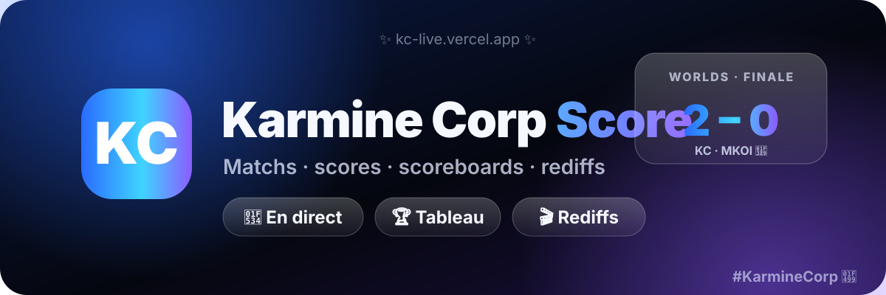

# Karmine Corp Score (KC Live)

<p align="center">
  
</p>

Suivi en direct de la **Karmine Corp** : matchs, scores, scoreboards complets, rediffs de chaque game et arbre des tournois, dans une interface pensée pour le téléphone (style « verre dépoli » d'iOS), installable comme une appli avec notifications.

**En ligne :** https://kc-live.vercel.app

> Projet de fan, sans but lucratif, sans publicité. Il n'est affilié ni à la Karmine Corp, ni à Riot Games, ni à PandaScore. Les noms d'équipes, logos et données appartiennent à leurs détenteurs respectifs.

**Tu as une idée pour l'appli ?** Un bug, une fonctionnalité, un design à revoir, une source de données à ajouter : ouvre une [issue](https://github.com/resim3/kc-kive/issues) ou propose une modification (pull request). Toutes les propositions sont les bienvenues, même petites.

---

## 📲 Mettre l'appli sur ton écran d'accueil

Pas besoin de store : ça s'installe depuis le navigateur, en 10 secondes.

### 🍎 iPhone / iPad (Safari)

1. Ouvre **https://kc-live.vercel.app** dans **Safari** (pas Chrome, ça ne marche pas sur iOS).
2. Touche le bouton **Partager** ⬆️ (le carré avec la flèche, en bas de l'écran).
3. Fais défiler et choisis **« Sur l'écran d'accueil »** ➕.
4. Valide **« Ajouter »**. L'icône KC apparaît sur ton écran, et l'appli s'ouvre en plein écran 🎉

> 🔔 Les notifications ne marchent sur iPhone qu'une fois l'appli ajoutée à l'écran d'accueil, puis ouverte depuis cette icône.

### 🤖 Android (Chrome, Edge, Samsung Internet…)

1. Ouvre **https://kc-live.vercel.app** dans **Chrome**.
2. Touche les **trois petits points** ⋮ en haut à droite.
3. Choisis **« Installer l'application »** ou **« Ajouter à l'écran d'accueil »** 📥.
4. Confirme. L'appli rejoint ton écran d'accueil et ton tiroir d'applis 🚀

> 💡 Si tu ne vois pas l'option, attends quelques secondes que la page finisse de charger, puis rouvre le menu.

---

## Ce que fait l'appli

- **Matchs en direct, à venir et résultats** de toutes les équipes Karmine Corp (LoL, Valorant, Rocket League, et les autres jeux couverts par PandaScore).
- **Rafraîchissement automatique** : toutes les 15 s pendant un match, toutes les 60 s sinon.
- **Scoreboard par match et par game** :
  - LoL : champions, K/D/A, CS, or, niveau, objets, part des dégâts, participation aux kills, tours, drakes, barons. Mise à jour toutes les minutes pendant un match en direct.
  - Autres jeux : compositions, et stats joueurs quand l'offre de données les inclut.
- **Bilan de la série** : score final, MVP (meilleur KDA de l'équipe gagnante), totaux de chaque joueur sur toutes les games, kills et durée de chaque game.
- **Rediffs** : un bouton « Revoir » ouvre la VOD de chaque game au bon moment (YouTube, en français quand elle existe).
- **Temps forts** : un bouton ouvre une recherche YouTube pour la game (« KC vs MKOI game 1 highlights »).
- **Arbre du tournoi** (LoL) : phase finale avec la finale au centre, système suisse, barrages. Affiché en feuille du bas sur téléphone, avec les matchs à venir (« TBD ») pour que tu voies où en est le tournoi.
- **Notifications** (PWA) : début de match, changement de score, victoire ou défaite.
- **Filtres par jeu** et installation sur l'écran d'accueil (iOS et Android).

---

## Architecture

```
kc-kive/
├── index.html        Structure de la page et de la feuille « Tableau »
├── style.css         Thème « Liquid Glass » : verre, dégradés, mode sombre/clair, mise en page téléphone
├── app.js            Interface : rendu des cartes, scoreboards, bilans, arbre, notifications, polling
├── sw.js             Service worker (installation PWA, clic sur notification)
├── manifest.json     Manifeste PWA
├── icon.svg          Icône
└── api/              Fonctions serverless Vercel (proxy, le token reste côté serveur)
    ├── matches.js    GET /api/matches  : liste des matchs (PandaScore)
    ├── match.js      GET /api/match?id= : détail d'un match, fusionne les deux sources
    ├── bracket.js    GET /api/bracket  : arbre du tournoi LoL (lolesports)
    ├── _pandascore.js  Client PandaScore : équipes KC, matchs, stats des games terminées
    └── _lolesports.js  Client lolesports : scoreboard LoL, VOD, arbre, recherche de match
```

Les fichiers préfixés par `_` ne sont pas exposés comme routes par Vercel : ce sont des modules partagés.

### Flux de données

1. **Liste des matchs** : `app.js` appelle `/api/matches`, qui interroge PandaScore (`running`, `upcoming`, `past`, filtrés sur les équipes KC). Les résultats sont retriés par date.
2. **Détail d'un match** : `/api/match?id=` lit la structure du match chez PandaScore (games, vainqueurs, durées, compositions).
   - Pour le **LoL**, il retrouve le match correspondant chez lolesports (recherche par date et acronyme d'équipe, à 12 h près), puis récupère les VOD et les statistiques de chaque game. Si lolesports ne répond pas, l'appli garde les données PandaScore.
   - Pour les **autres jeux**, il utilise les stats PandaScore quand l'offre les inclut, sinon affiche les compositions seules.
3. **Arbre** : `/api/bracket` retrouve le tournoi via lolesports et renvoie les tours. Le front reconstruit l'arbre : élimination directe en miroir, classement suisse calculé à partir des résultats.
4. **Cache** : les réponses sont mises en cache par le CDN Vercel (10 s pour la liste, 30 s à 10 min pour le détail selon qu'un match est en cours). Les statistiques d'une game terminée sont gardées en mémoire, car elles ne changent plus.

---

## Sources de données

| Source | Utilisée pour | Statut |
|---|---|---|
| **[PandaScore](https://pandascore.co)** | Liste des matchs de tous les jeux, équipes, compositions, structure des games | API payante avec offre gratuite. Clé personnelle requise. |
| **[lolesports](https://lolesports.com)** (Riot Games) | Scoreboard LoL complet, VOD par game, arbre des tournois LoL | **API non officielle**, utilisée avec la clé publique du site. Riot peut la modifier ou la couper sans prévenir. |
| **[Data Dragon](https://developer.riotgames.com/docs/lol#data-dragon)** (Riot) | Noms et images des champions et objets | Public |

Si lolesports est indisponible, l'appli continue avec PandaScore seul : les scoreboards LoL affichent alors les compositions, et l'arbre n'est pas disponible.

---

## Installation en local

Prérequis : Node.js 18 ou plus récent, un compte Vercel (pour les variables d'environnement) et un token PandaScore.

```bash
git clone https://github.com/resim3/kc-kive.git
cd kc-kive
npm i -g vercel
vercel link            # relie le dossier à ton projet Vercel
vercel env pull        # récupère les variables (PANDASCORE_TOKEN)
vercel dev             # lance l'appli sur http://localhost:3000
```

Sans `vercel dev`, l'interface s'ouvre mais l'API ne répond pas : les routes `/api/*` sont des fonctions serverless.

## Variables d'environnement

Définies sur Vercel, jamais dans le code :

| Variable | Obligatoire | Rôle |
|---|---|---|
| `PANDASCORE_TOKEN` | oui | Token d'accès à l'API PandaScore |
| `KC_TEAM_IDS` | non | IDs des équipes KC séparés par des virgules. Si absent, ils sont recherchés automatiquement. |
| `LOLESPORTS_KEY` | non | Clé de l'API lolesports. Ne l'utiliser que si Riot change la clé publique du site. |

## Déploiement

```bash
vercel --prod
```

Le projet est déployé automatiquement sur Vercel à chaque commande ci-dessus.

---

## Limites connues

- **Stats des joueurs PandaScore** : selon l'offre, elles peuvent être verrouillées (l'appli affiche alors « non incluses dans ton offre »). Pour le LoL, lolesports les fournit.
- **Historique lolesports** : les matchs LoL trop anciens (plus de 2 à 3 mois) ne sont souvent plus dans le calendrier lolesports. L'appli retombe alors sur PandaScore.
- **Arbre** : les tableaux à double élimination ou avec petite finale s'affichent en liste simple, pas en arbre.
- **Valorant et Rocket League** : pas de scoreboard détaillé ni de VOD, faute de source gratuite fiable.
- **Notifications iOS** : ne fonctionnent que si l'appli est ajoutée à l'écran d'accueil.

## Idées pour la suite

- Scoreboard Rocket League (buts, arrêts, par joueur) via l'API Octane.
- Temps forts officiels via l'API YouTube, au lieu de la recherche.
- Clips Twitch par game, via l'API Twitch.
- Mode clair plus travaillé sur la feuille « Tableau ».

## Crédits

Fait par un fan, pour les fans de la Karmine Corp. Merci à PandaScore, à lolesports et à Riot Games pour les données.

Pour la KC, pour la communauté, pour les soirées où on crie devant l'écran 💙💜 **#KarmineCorp #KCLive**

🤖 Generated with [Claude Code](https://claude.com/claude-code)
